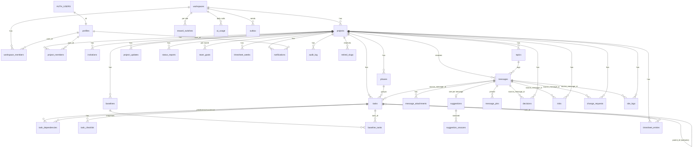

# Plenum: Backend schema

Version 1.0 · 2026-10-27 · Companion to [TRD.md](TRD.md). Schema `public` on Supabase project `uwimagjkbwourvepvtns` (Postgres 17, eu-west-1).

Sources: the 67 migration files in `supabase/migrations/` on `main`, checked read-only against the live project (catalog queries only, no writes). Live had 66 migration records, last `20261027093656 message_topics`.

## 0. Drift between repo and live (read first)

| Item | Repo (`main`) | Live project | Action |
|---|---|---|---|
| `topics` table, `messages.topic_id`, `create_topic()`, `set_message_topic()` (migration `message_topics`) | No migration file | Present (0 topics, 0 messages tagged) | Add the migration file to the repo (probably the Stream work); until then `db-migrate` will not know it |
| Migration 146 `site_log_submit` (`site_logs.submitted_at`, `submitted_by`, new `save_site_log` and submit function) | Present | **Not applied**: `site_logs` has no submit columns | Apply it (`/mnt/project-files/db/apply-146.sql` exists) |
| Migrations 144 (`task_numbers`) and 145 (`suggestion_reason`) | Present | Applied (`tasks.number`, `suggestions.reason` exist) | None |
| `message_source` enum | `email` only in the repo state read | `email` only | Teams values will need a migration |

**Security finding (live, needs a fix migration).** `create_topic`, `set_message_topic` and the live `save_site_log` guard with `if public.project_role_of(p) not in ('member','project_manager') then raise …`. For a caller with no role in the project (a signed-in outsider, or `anon`, which also holds EXECUTE) `project_role_of` returns NULL, `NULL NOT IN (…)` is NULL, and PL/pgSQL treats the `IF` as false, so the guard does not raise and the SECURITY DEFINER body runs. Contributors are blocked; outsiders are not. Fix pattern already used elsewhere in the repo: `if p is null or public.project_role_of(p) is null or … not in (…)`, plus `revoke execute … from anon`. Migration 146 repeats the same pattern for `save_site_log` and its submit function, so it needs the same correction before it is applied.

## 1. Enums

| Type | Values |
|---|---|
| `project_role` | project_manager, member, contributor |
| `workspace_role` | member, admin |
| `member_kind` | staff, contributor |
| `task_status` | todo, in_progress, blocked, done |
| `task_priority` | low, normal, high |
| `project_health` | on_track, at_risk, off_track |
| `message_source` | email |

Extensions: `pg_trgm` (sender search), `pgcrypto`, `uuid-ossp`, `pg_stat_statements`, `supabase_vault`.

## 2. ER diagram

Standalone tables (no foreign keys): `job_runs`, `platform_limits`, `rate_limits`.

## 3. Tables

Legend: **PK** primary key · **FK** foreign key · NN not null · defaults in `=`. All tables have RLS enabled.

### 3.1 Tenancy and people
**workspaces**: `id` uuid PK =gen_random_uuid · `name` text NN (non-blank) · `created_at` timestamptz NN =now · `retention_days` int null (null keeps everything, else ≥ 30).

**workspace_members**: PK (`workspace_id`, `user_id`) · `workspace_id` FK→workspaces cascade · `user_id` FK→profiles cascade · `kind` member_kind NN =staff · `role` workspace_role NN =member · `created_at`. Check: a contributor cannot be admin. Index on `user_id`.

**profiles**: `id` uuid PK, FK→auth.users cascade · `display_name` text NN · `email` text NN · `locale` text NN =en (two letters) · `digest_daily` bool =false · `digest_suggestions` bool =true · `digest_due` bool =true · `created_at`.

**projects**: `id` uuid PK · `workspace_id` FK→workspaces cascade · `name` text NN · `email_slug` text NN **unique**, `^[a-z0-9][a-z0-9-]{1,62}$` · `created_by` FK→profiles set null · `created_at` · `archived_at` · `task_counter` int NN =0 (source of `tasks.number`).

**project_members**: PK (`project_id`, `user_id`) · `role` project_role NN · `created_at`. Index on `user_id`.

**invitations**: `id` PK · `project_id` FK cascade · `email` text NN (lower-case, contains @) · `role` project_role NN · `invited_by` FK→profiles set null =auth.uid() · `created_at` · `accepted_at` · `expires_at` NN =now()+14 days. Unique (`project_id`, `email`) where `accepted_at is null`.

**retired_slugs**: PK `slug` · `project_id` FK cascade · `retired_at`. Reserves an old email address after a rename.

### 3.2 Plan
**phases**: `id` PK · `project_id` FK cascade · `name` NN · `position` int NN =0 · `created_at`. Index `project_id`.

**tasks**: `id` PK · `project_id` FK cascade · `phase_id` FK→phases set null · `parent_id` FK→tasks cascade (one level, enforced by trigger) · `title` NN · `owner_id` FK→profiles set null · `start_date`, `due_date` date (start ≤ due) · `status` task_status =todo · `priority` task_priority =normal · `cost_code` text · `position` int =0 · `source_message_id` FK→messages set null · `details` text NN =''(≤ 5000) · `site` text NN =''(≤ 80) · `is_milestone` bool =false · `number` int NN (per-project, set by trigger) · `created_at`, `updated_at`.
Indexes: unique (`project_id`, `number`); (`project_id`, `created_at` desc, `id` desc) for paging; GIN full-text on title+details; `owner_id`; `source_message_id`; `project_id`.

**task_dependencies**: PK (`predecessor_id`, `successor_id`) · both FK→tasks cascade · `kind` text =FS (FS, SS, FF, SF) · `lag_days` int =0 (±3650) · predecessor ≠ successor. Index `successor_id`.

**task_checklist**: `id` PK · `task_id` FK cascade · `text` NN (≤ 300) · `done` bool =false · `position` int =0 · `created_at`. Index (`task_id`, `position`).

**baselines**: `id` PK · `project_id` FK cascade · `name` text NN (1 to 80) · `created_at`. Index (`project_id`, `created_at` desc).
**baseline_tasks**: PK (`baseline_id`, `task_id`) · both FK cascade · `start_date`, `due_date` NN.

### 3.3 Messages and AI
**messages**: `id` PK · `project_id` FK cascade · `source` message_source NN =email · `external_id` text NN · `from_name`, `from_address` NN · `to_addresses`, `cc_addresses` text[] · `subject`, `body_text` NN =''· `sent_at`, `received_at` =now · `raw_location` (S3 key) · `purged_at` · `topic_id` (live only; composite FK (`topic_id`, `project_id`)→topics, set null on topic).
Unique (`project_id`, `external_id`) and (`id`, `project_id`). Indexes: paging (`project_id`, `received_at` desc, `id` desc); GIN `search_vec(subject, body_text, sender)`; GIN trigram on `from_address` and `from_name`.

**message_attachments**: `id` PK · `message_id` FK cascade · `part_index` int · `filename`, `content_type`, `size_bytes` · `doc_type` (drawing, specification, permit, report, other) · `doc_ref` · `revision` (needs `doc_ref`). Unique (`message_id`, `part_index`); index on `lower(doc_ref)`.

**message_pins**: PK `message_id` · FK (`message_id`, `project_id`)→messages cascade · `pinned_by` FK→profiles =auth.uid() · `pinned_at`. Index (`project_id`, `pinned_at` desc).

**topics** (live only): `id` PK · `project_id` FK cascade · `name` (1 to 80) · `created_at`; unique (`id`, `project_id`).

**suggestions**: `id` PK · `project_id` · `message_id` (composite FK (`message_id`, `project_id`)→messages cascade, **unique** so one per message) · `kind` (task, decision, risk, change_request) · `title` NN · `details` · `reason` NN (non-blank) · `status` (pending, accepted, dismissed) =pending · `resolved_by` FK→profiles set null · `resolved_at` · `created_at`. Index (`project_id`, `status`).
**suggestion_snoozes**: PK (`user_id`, `suggestion_id`) · `until` timestamptz NN.

**ai_usage**: PK (`workspace_id`, `day`) · `calls` int =0. Daily model-call counter.

### 3.4 Items
**decisions**, **change_requests**, **risks** share: `id` PK · `project_id` FK cascade · `source_message_id` FK→messages set null · `title` NN · `details` =''· `created_by` FK→profiles set null =auth.uid() · `created_at`.
- change_requests: `status` (proposed, approved, rejected) =proposed.
- risks: `status` (open, closed) =open · `kind` (risk, issue) =risk · `owner_id` FK→profiles set null · `due_date`.
Indexes on each: `project_id`, `source_message_id`, paging (`project_id`, `created_at` desc, `id` desc); decisions also GIN full-text; risks also `owner_id`.

### 3.5 Time, site and reporting
**timesheet_entries**: `id` PK · `project_id` FK · `task_id` FK→tasks cascade · `user_id` FK→auth.users cascade · `work_date` · `hours` numeric(4,2) (> 0, ≤ 24). Unique (`task_id`, `user_id`, `work_date`); index (`user_id`, `project_id`, `work_date`).
**timesheet_weeks**: PK (`project_id`, `user_id`, `week_start`; Monday only) · `status` (submitted, approved, sent_back) =submitted · `note` (≤ 500) · `submitted_at` · `decided_by` · `decided_at`.
**site_logs**: `id` PK · `project_id` · `site` (1 to 100) · `log_date` · `weather`, `headcount` (0 to 100000), `work_done`, `delays` · `source_message_id` FK→messages set null. Unique (`project_id`, `site`, `log_date`). Migration 146 adds `submitted_at`, `submitted_by` (not yet live).
**project_updates**: `id` PK · `project_id` · `health` project_health · `note` (1 to 1000) · `author_id` FK→profiles =auth.uid() · `created_at`.
**status_reports**: `id` PK · `project_id` · `week_start` · `body_text` · `sent_at` · `sent_by`. Unique (`project_id`, `week_start`).
**team_goals**: PK (`project_id`, `month`; first of month). **reward_switches**: PK (`workspace_id`, `site` ≤ 80).

### 3.6 Platform
**audit_log**: `id` bigint PK · `workspace_id` · `project_id` · `actor_id` · `action` NN · `entity_type` NN · `entity_id` NN · `source_message_id` · `created_at`. Append-only (triggers block update, delete and truncate). Indexes (`project_id`, `created_at`), (`workspace_id`, `created_at`), paging (`project_id`, `created_at` desc, `id` desc).
**notifications**: `id` PK · `user_id` FK→profiles cascade · `project_id` FK cascade · `kind` (task_assigned, suggestion_new, invitation_accepted) · `subject` · `ref_id` · `created_at` · `read_at`. Indexes (`user_id`, `created_at` desc), paging by project.
**outbox**: `id` PK · `workspace_id` FK cascade · `project_id` FK cascade · `to_addresses` text[] (non-empty) · `subject`, `body_text` · `status` (fake, sent, failed) =fake · `error` · `attempt` int =1 · `retried` bool · `created_at`. Index (`workspace_id`, `created_at` desc).
**job_runs**: PK `job` · `last_run_at` · `ok` · `detail`. **rate_limits**: PK `key` · `window_start` · `hits`. **platform_limits**: PK `key` · `value` ≥ 0.

## 4. Row-level security

All access goes through helper functions (security definer, stable): `can_see_project(p)`, `can_manage_project(p)` (project manager), `project_role_of(p)`, `is_workspace_admin(ws)`, `is_workspace_member(ws)`, `is_workspace_staff(ws)`, `visible_project_ids()`.

| Table | Read | Write from the client |
|---|---|---|
| workspaces | workspace members | admins update |
| workspace_members | self, workspace admins | admins (all) |
| profiles | self and people sharing a project | self update |
| projects | `can_see_project` | staff insert in their workspace (`created_by = auth.uid()`); managers update |
| project_members | `can_see_project` | managers insert, update, delete |
| invitations | managers | managers insert, resend, withdraw (unaccepted only) |
| phases, decisions, risks, change_requests | `can_see_project` | managers (all) |
| tasks | `can_see_project` | managers insert and delete; managers or the owner update |
| task_dependencies | via predecessor's project | managers |
| task_checklist | via task's project | managers or task owner |
| baselines, baseline_tasks, message_pins, project_updates, team_goals, site_logs, reward_switches, topics | `can_see_project` (reward switches: workspace members) | pins: managers insert/delete; updates: managers insert; rest: functions only |
| messages, message_attachments | `visible_project_ids()` / via message | none (ingest function only) |
| suggestions | `can_see_project` | managers update (status and wording) |
| suggestion_snoozes | own rows | own rows |
| notifications | own rows in visible projects | own rows update (mark read) |
| timesheet_entries | own rows | none (`save_hours`) |
| timesheet_weeks | own rows, managers | own insert (status submitted); owner or manager update |
| audit_log | managers, workspace admins | none (triggers only) |
| outbox | managers, workspace admins | none |
| status_reports | managers | none |
| ai_usage, job_runs, rate_limits, platform_limits, retired_slugs | no policy: service role only | service role only |

Five tables have RLS on and no policy by design (the last row).

## 5. Functions and RPCs

Client-callable (`authenticated`):
| Function | Purpose |
|---|---|
| `create_project(workspace, name, slug)` · `create_project_from(source, name, slug)` | New project; copy from a template project |
| `onboard(workspace_name, project_name, slug, with_demo)` | First-run wizard |
| `accept_my_invitations()` | Add the signed-in user to projects they were invited to |
| `accept_suggestion(id, kind, title, details)` | Create the item from a suggestion (keeps source message; invoker, so RLS applies) |
| `save_baseline(project, name)` · `audit_dependency_import(project)` | Baselines; audit of imported dependencies |
| `save_hours(task, date, hours)` · `my_week_activity(project, from, to)` | Timesheet writes and AI-draft input |
| `week_counts` · `week_detail` · `week_hours` · `timesheet_export` | Timesheet reads for managers and export |
| `save_site_log(…)` · `tag_attachment(attachment, type, ref, revision)` | Site log upsert; tag a document |
| `set_team_goal` · `team_goal_progress` · `team_goal_history` · `set_reward_switches(ws, sites)` | Rewards |
| `task_activity(task)` | Task history for the inspector |
| `search_project(project, q, skip, since, until, task)` | Full-text search over messages, tasks, decisions, risks |
| `send_status_report(id)` · `audit_reply(message)` | Report send data; reply audit |
| `export_workspace(ws)` · `delete_project(p)` · `remove_person(ws, person)` | Export and deletion (admin) |
| `create_topic` · `set_message_topic` | Topics (live only; see §0) |

Service role only: `ingest_email(slug, external_id, from…, attachments jsonb)`, `claim_job`, `claim_failed_emails`, `draft_status_reports`, `daily_digests`, `purge_expired_messages`, `rate_limit_hit(key, limit, window)`, `take_ai_call(workspace, cap)`, `write_audit`, `seed_demo_project`, `week_locked`.
Search helpers (`search_query`, `search_vec`, `search_snippet`, `superseded`) and `pg_trgm` functions are granted to all roles but expose no data. `create_topic` and `set_message_topic` are also executable by `anon`.

## 6. Triggers

Trigger and function names, timing and events were read from the live catalog. The one-line purposes below are inferred from the names and the repo migrations; function bodies were read only for `create_topic`, `set_message_topic` and `project_role_of`.

| Table | Trigger → function |
|---|---|
| audit_log | `no_change` (update/delete), `no_truncate` → `audit_log_is_append_only` |
| tasks | `number` → `set_task_number`; `check_shape` (one-level subtasks, same project); `check_source` → `check_source_message`; `limit_edits` → `limit_task_edits` (what owners may change); `audit` / `audit_edit`; `notify_assigned` |
| decisions, risks, change_requests | `check_source` (source message must be in the same project); `audit` → `audit_item_created`; risks also `check_owner` |
| suggestions | `stamp_decision` (resolver, time; decided rows frozen); `audit` → `audit_suggestion_decided`; `notify_new` |
| task_dependencies | `check` → `check_dependency` (same project, no cycles); `audit` (insert/delete) |
| projects | `add_creator` (creator becomes manager); `new_slug_free`; `reserve_old_slug`; `lock_fields` |
| project_members | `check` → `check_project_member`; `audit` → `audit_role_changed` |
| workspace_members | `keep_last_admin` (update/delete) |
| invitations | `notify_accepted` |
| phases | `lock_project` (cannot move to another project) |
| timesheet_weeks | `check` → `check_timesheet_week` (approved weeks lock) |

## 7. How to keep this file true
- Source of truth is `supabase/migrations/`; regenerate this file from the live catalog (columns, constraints, indexes, `pg_policies`, `pg_proc`, triggers) after each batch of migrations and compare with the repo.
- Every new table ships with its policies and a test in `supabase/tests/*_rules.sql`.
- Any function that guards by role must handle a NULL role (see §0).
